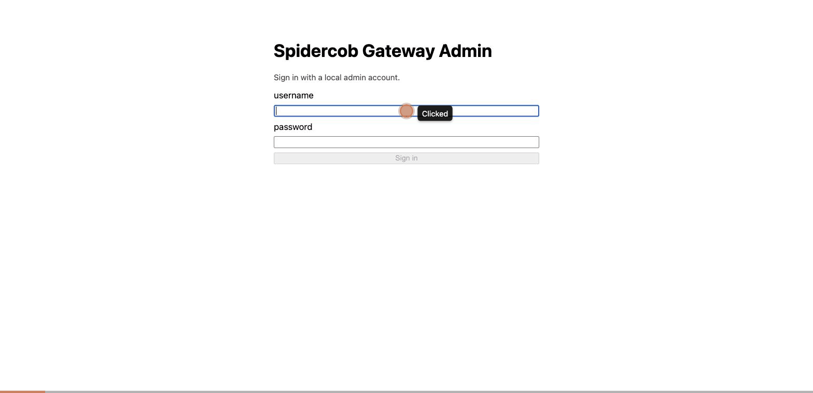

# Spidercob Gateway

**Open-source guardrails for AI agents.**

Spidercob sits between your AI agents and the MCP servers they use. It stops agents leaking secrets and personal
data, blocks tools that change behind your back, and gives every agent a real identity. Free, Apache-2.0, one container.



*An agent calls a tool that returns a raw card number. The gateway redacts it (`[REDACTED:credit-card]`) before it
reaches the agent, and the call appears in the tamper-evident audit log.*

## What it stops

- **Leaks.** Secrets (AWS keys, tokens, high-entropy strings) and personal data (card numbers, SSNs, emails, phone
  numbers) are redacted in tool responses before your agent sees them. Prompt-injection text hidden in responses,
  including homoglyph and zero-width tricks, is flagged.
- **Tool rug-pulls.** Every tool's definition is pinned the first time it's seen. If an MCP server quietly changes a
  tool later, the tool is quarantined and hidden until you approve it again.
- **Anonymous agents.** No more shared static API keys: each agent gets its own short-lived, per-server token, and
  group policies decide which servers and tools it can use. Everything is denied until you allow it.

Every request, allowed or denied, lands in a hash-chained audit log. There's an admin UI at `/ui/`.

## Try it

```bash
git clone https://github.com/SpiderCob/spidercob-gateway && cd spidercob-gateway
cp config.example.json config.json   # point "nodes" at your MCP servers
```

Add an agent and give it access to one of your nodes in `config.json`:

```json
{
  "seed_agents": [
    { "client_id": "demo-agent", "client_secret": "change-me", "name": "local demo", "groups": ["demo"] }
  ],
  "policies": [
    { "group": "demo", "node": "<node-name>", "rule_type": "allow" }
  ]
}
```

```bash
docker compose up --build

# get a token for that node
curl -s http://localhost:8080/token \
  -d grant_type=client_credentials -d client_id=demo-agent -d client_secret=change-me -d resource=<node-name>
```

Then point your MCP client at `http://localhost:8080/mcp/<node-name>` with `Authorization: Bearer <access_token>`.
To see redaction work, put a fake AWS key (`AKIA` + 16 characters) in any tool response: it comes back as
`[REDACTED:aws-access-key]`.

No Docker? `make run` builds the admin UI and runs the gateway with your local Go toolchain (Go and Node.js needed).

## Use it with Claude Code, Claude Desktop or Cursor

Interactive clients shouldn't have to juggle expiring tokens. `spidercob connect` runs a small local sidecar that
holds the agent's credential and refreshes tokens in the background:

```bash
export SPIDERCOB_CLIENT_SECRET=change-me
spidercob connect -gateway http://localhost:8080 -client-id demo-agent -node <node-name>
```

Point your client at the local URL it prints instead of the MCP server.

## Install

Signed binaries for Linux and macOS (amd64/arm64) are on the
[Releases page](https://github.com/SpiderCob/spidercob-gateway/releases), signed with Sigstore/cosign
([how to verify](docs/verify-release.md)). Container images (`ghcr.io/spidercob/spidercob-gateway`) start with the
next release; Homebrew is coming.

## Status

Pre-alpha: it works end to end and is tested (unit tests plus real end-to-end runs against the compiled binary), but
it isn't production-ready yet. Known gaps:

- On streamed (SSE) responses, redaction covers secrets, card numbers and SSNs; email/phone detection, entropy and
  injection scanning currently run on non-streamed responses only.

Also included: external IdP support (ID-JAG / MCP Enterprise-Managed Authorization, tested against Keycloak), CSV user
import for teams without an identity provider, Prometheus metrics and health probes, and `spidercob-admin`, which lets
you manage the gateway from an MCP client.

## Learn more

- [Detailed feature notes and roadmap](docs/ROADMAP.md)
- [Design](docs/design.md) · [Spec conformance](docs/spec/conformance.md) · [Observability](docs/observability.md)

## Contributing

Issues and pull requests are welcome. Good first contributions: new scanner rules. Please report security issues
privately as described in [SECURITY.md](SECURITY.md).

## License

Apache-2.0. Part of [Spidercob](https://spidercob.com), open-source guardrails for AI agents.
