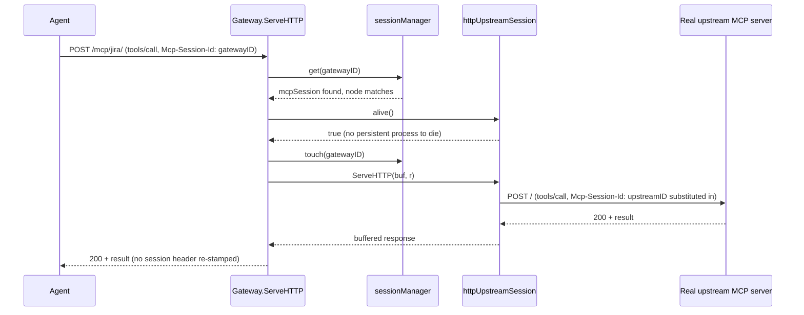
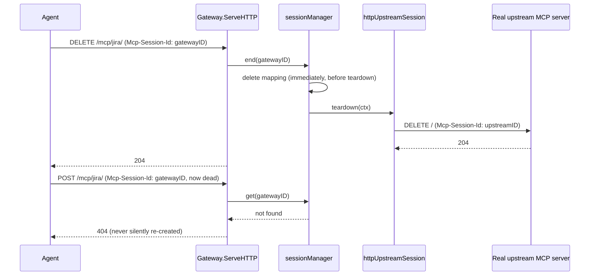
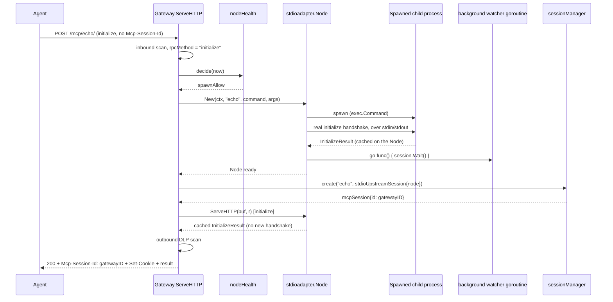
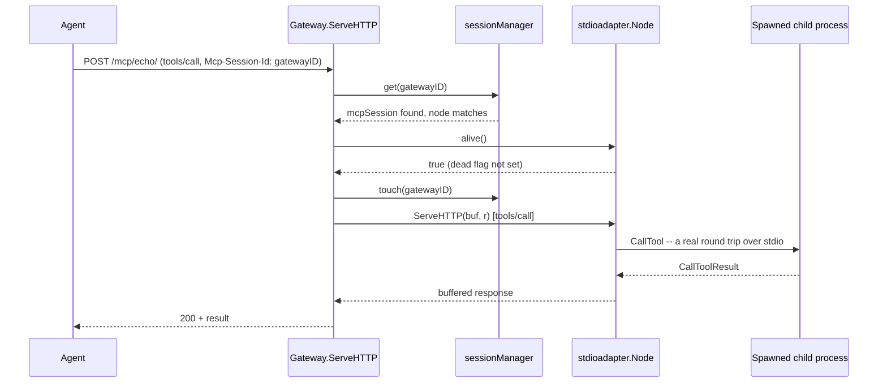
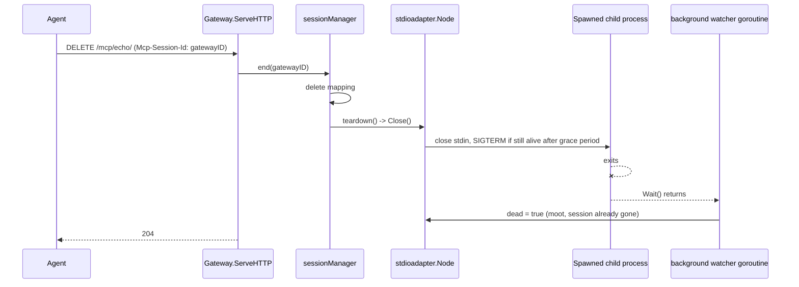
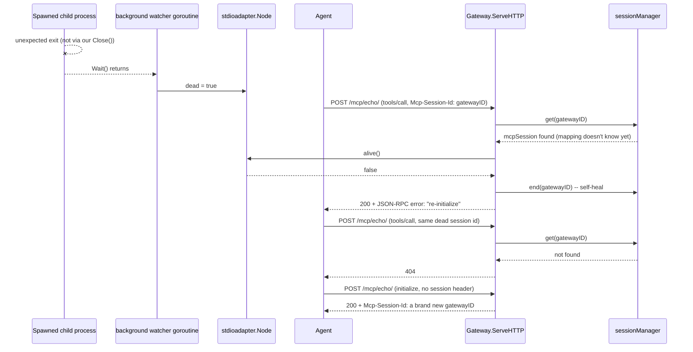

# Session Lifecycle: HTTP vs. stdio

Companion to `MASTER_PLAN.md` §3 (Phase 1) and the code in `internal/proxy/` — the
"how" behind session mapping, for both transports, as three request
lifecycles: establishing a session (`initialize`), continuing one
(`tools/call`), and ending one (`DELETE`). A fourth diagram covers the
stdio-only crash/self-heal path, which has no HTTP equivalent.

The one constant across every diagram: `Gateway.ServeHTTP` and
`sessionManager` are fully transport-agnostic. Everything that differs
lives inside `sessionUpstream` — `httpUpstreamSession` or
`stdioUpstreamSession`.

## HTTP-backed node (e.g. `jira`)

### `initialize` — new session

```mermaid
sequenceDiagram
    participant Agent
    participant Gateway as Gateway.ServeHTTP
    participant Sessions as sessionManager
    participant HTTPUp as httpUpstreamSession
    participant Upstream as Real upstream MCP server

    Agent->>Gateway: POST /mcp/jira/ (initialize, no Mcp-Session-Id)
    Gateway->>Gateway: inbound scan, rpcMethod = "initialize"
    Gateway->>HTTPUp: newUpstream() -- just a struct, no connection yet
    Gateway->>Sessions: create("jira", httpUp)
    Sessions-->>Gateway: mcpSession{id: gatewayID}
    Gateway->>HTTPUp: ServeHTTP(buf, r)
    HTTPUp->>Upstream: POST / (initialize, Mcp-Session-Id stripped)
    Upstream-->>HTTPUp: 200 + Mcp-Session-Id: upstreamID + result
    HTTPUp->>HTTPUp: capture upstreamSessionID; strip header from response
    HTTPUp-->>Gateway: buffered response (no upstream session id)
    Gateway->>Gateway: outbound DLP scan
    Gateway-->>Agent: 200 + Mcp-Session-Id: gatewayID + Set-Cookie + result
```

Note the ordering: the gateway's session ID is minted *before* the real
upstream round trip happens. The upstream's own session ID is only known
once its response comes back -- captured into `httpUp.upstreamSessionID`
for every later request on this session.

### Continuing `tools/call`



### `DELETE`



## stdio-backed node (e.g. `echo`)

### `initialize` — spawns a dedicated process for this session



The real handshake already happened *inside* `New`, before the session
even exists in `sessionManager` -- the opposite order from HTTP, where the
session is minted before the real upstream call.

### Continuing `tools/call`



### `DELETE`



### Bonus: unexpected crash mid-session -- self-heal

The one path with no HTTP equivalent at all, since HTTP upstreams have no
persistent process to crash.



Note the real race this diagram simplifies: there's a small window between
the process actually dying and the watcher goroutine noticing. A request
landing in that window instead fails via `CallTool`'s own error return
(the normal dispatch path, session not yet cleaned up) rather than the
`alive()` check catching it -- the *following* request is what's
guaranteed to see it as gone. `TestGateway_StdioCrashMidSessionFailsCleanlyThenSelfHeals`
polls for this rather than asserting on a single specific request.
